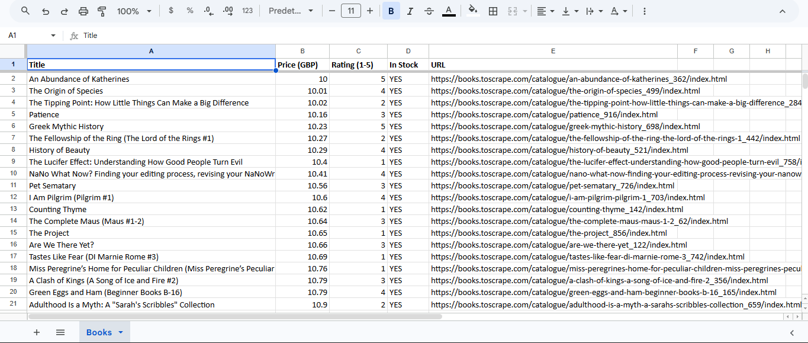
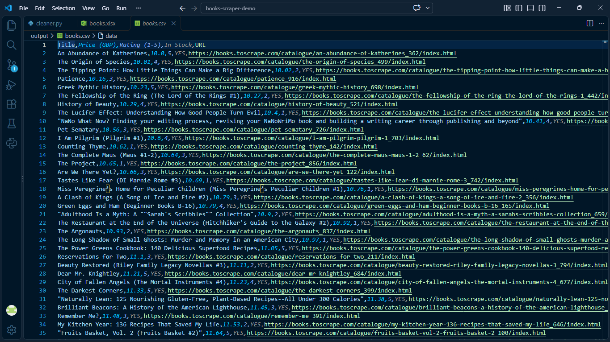

# Books Scraper Demo

Demo project: extracts book data from [books.toscrape.com](https://books.toscrape.com/) (a site built for scraping practice), cleans it, and delivers it as CSV and Excel.

**Demo de extracción y limpieza de datos con Python:** recorre todas las páginas del catálogo, normaliza los datos, elimina filas inválidas y duplicados, y entrega un CSV y un Excel listos para usar.

## Qué hace

1. **Extrae** título, precio, valoración, disponibilidad y enlace de cada libro (50 páginas, ~1000 libros).
2. **Limpia**: convierte el precio a número, la valoración a escala 1-5, elimina filas sin título o precio y descarta duplicados.
3. **Exporta** a `output/books.csv` y `output/books.xlsx` (con encabezados y columnas formateadas).
4. **Informa** un resumen de control de calidad (registros crudos, inválidos, duplicados, limpios, páginas fallidas).

Incluye reintentos con espera creciente, pausas aleatorias entre requests y tests que corren sin conexión.

## Uso

```bash
python -m venv venv
source venv/bin/activate        # Windows: venv\Scripts\activate
pip install -r requirements.txt

python main.py                  # todas las páginas
python main.py --pages 3        # solo 3 páginas (prueba rápida)
python test_parsing.py          # tests offline
```

## Estructura

| Archivo | Responsabilidad |
|---|---|
| `config.py` | Parámetros (URL, reintentos, pausas) |
| `scraper.py` | Descarga y parseo del HTML |
| `cleaner.py` | Limpieza y control de calidad |
| `exporter.py` | Exportación a CSV y Excel |
| `main.py` | Orquesta todo el proceso |
| `test_parsing.py` | Tests sin conexión |

## Resultado de ejemplo






## Nota

Este sitio existe para practicar scraping. Para sitios reales, revisá siempre los términos de uso y el archivo `robots.txt` antes de extraer datos.

---

